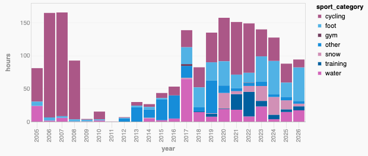

# activity-sette

Parse FIT/GPX/TCX fitness activity exports (including native Garmin `.fit` files) into a
SQLite database and explore them in a local [Datasette](https://datasette.io) running in Docker.

## Demo

Opening the URL `http://localhost:8001/activities?sql=select+year%2C+sport_category%2C%0D%0A++count%28*%29+as+activities%2C%0D%0A++round%28sum%28distance_m%29+%2F+1000%2C+1%29+as+km%2C%0D%0A++round%28sum%28duration_s%29+%2F+3600.0%2C+1%29+as+hours%2C%0D%0A++round%28sum%28calories%29%29+as+calories%0D%0Afrom+activities%0D%0A---+where+sport_category+%3D+%27water%27%0D%0Agroup+by+year%2C+sport_category%0D%0Aorder+by+year%2C+hours+desc#g.mark=bar&g.x_column=year&g.x_type=ordinal&g.y_column=hours&g.y_type=quantitative&g.color_column=sport_category` will show this chart:



`http://localhost:8001/activities?sql=select+month%2C+sport_category%2C%0D%0A++count%28*%29+as+activities%2C%0D%0A++round%28sum%28distance_m%29+%2F+1000%2C+1%29+as+km%2C%0D%0A++round%28sum%28duration_s%29+%2F+3600.0%2C+1%29+as+hours%2C%0D%0A++round%28sum%28ascent_m%29%29+as+ascent_m%0D%0Afrom+activities%0D%0Awhere+%28%3Asport+%3D+%27%27+or+sport+%3D+%3Asport%29%0D%0Agroup+by+month%2C+sport%0D%0Aorder+by+month+desc%2C+hours+desc&sport=#g.mark=bar&g.x_column=month&g.x_type=ordinal&g.y_column=hours&g.y_type=quantitative&g.color_column=sport_category`

## Quick start

```sh
docker compose build                    # image with Datasette + plugins + importer
docker compose run --rm importer        # parse ./activities -> ./data/activities.db
docker compose up -d                    # http://localhost:8001
```

Re-run the importer whenever you add files or change `config/sports.toml`. It rebuilds the
whole database (~15 s for ~430 files) and swaps it in atomically, so a running
Datasette picks up the changes without a restart.

Other importer invocations:

```sh
docker compose run --rm importer import /activities --no-trackpoints   # smaller DB
docker compose run --rm importer inspect "/activities/2014-09-20_Walking.tcx"
```

### Running the scripts without Docker

```sh
python3 -m venv .venv && .venv/bin/pip install -e '.[timezones,dev]'
.venv/bin/activity-sette import activities          # writes data/activities.db
.venv/bin/pytest
```

## Database

| Table | Contents |
|---|---|
| `activities` | One row per real-world activity: sport, local/UTC times, distance, durations, elevation, HR, cadence, calories, start/end/bbox coordinates, simplified GeoJSON `route`, data-availability flags (`has_gps`, `has_hr`, …) |
| `laps` | TCX/FIT lap summaries |
| `trackpoints` | Every sample (time, lat/lon, elevation, HR, cadence, distance) of each activity |
| `recordings` | Every parsed file/segment and its role: `primary`, `duplicate`, `fragment`, `empty` |
| `source_files` | Every file seen, with parse status/errors |

Datasette has canned queries for monthly/yearly/weekly totals, the longest activities per
sport, running pace, HR by sport, time-of-day patterns, per-activity maps
(`activity_points`), route maps by sport, data coverage, and a `needs_review` list.
To change them, edit [`datasette/metadata.yml`](datasette/metadata.yml). It is
mounted into the container, so run `docker compose restart datasette` to apply your edits.

## How the source quirks are handled

- **Sport taxonomy.** TCX `Sport` is only `Running`/`Biking`/`Other`. The real type usually
  lives in the export file name (`…_MtnBiking.tcx`) or the title (`Newcastle Windsurfing`).
  The sport is resolved in this order: overrides, regex rules on the title or file name,
  the file-name label, GPX `<type>`, weak title rules, and finally the device sport. All
  of these are configurable in [`config/sports.toml`](config/sports.toml), along with a
  sport→category roll-up. Free-text descriptions are ignored, because they often mention
  other sports.
- **Duplicates.** Garmin exports often appear twice (`2013-01-08_Other.tcx` and
  `2013-01-08_12-28-05_Other.tcx`). A handheld GPS and a watch can also record the same
  outing. Recordings that share an id (the TCX `Id`; FIT sessions use their start time,
  which matches that convention), or whose time ranges overlap by at least 50%, merge into
  one activity. The richest recording (HR, then native FIT/TCX, then GPS point count)
  becomes the primary. The other recordings stay visible in `recordings`. If the copies
  disagree on sport (e.g. Running vs Walking), the activity gets `sport_conflict = 1`.
- **GPS "active logs".** GPSMAP GPX files can span weeks. Tracks are split at gaps longer than
  `gpx_split_gap_hours`. Tiny pieces are kept only as `fragment` recordings.
- **Missing streams.** Metrics are null rather than zero when data is missing.
  Distance comes from the first available source, in this order: lap totals, the
  device's cumulative distance, then the GPS track (`distance_source` records which
  one was used). Moving time needs positions or distance. HR uses a time-weighted average
  of the samples, or falls back to lap averages.
- **Time zones.** Source timestamps are UTC. The local time zone comes from the start
  position (via `timezonefinder`). Without GPS it falls back to `default_timezone`;
  `timezone_source` shows which was used.
- **Notes.** Garmin Connect writes the title on the first line and your description below
  it. These become `name` and `description`, and both are full-text searchable.

## Fixing classifications

The `needs_review` query lists activities that are unclassified or have a conflicting
sport. Add entries to `[overrides]` (keyed by file name or activity id) or new `[[rules]]`
in `config/sports.toml`, then run the importer again.
